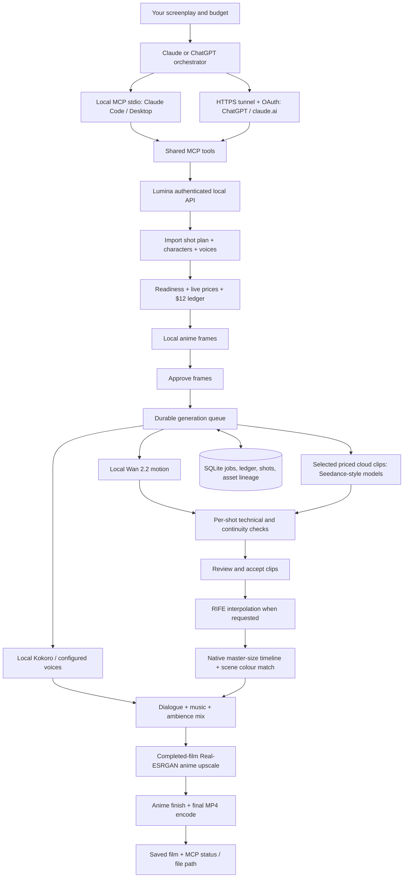

# Anime production in Lumina 0.9.3

## The $12 workflow

1. Settings → Budget → **Use $12 anime budget**. This enables priced-request checks, counts existing spending, keeps $1 for retries, and refuses unknown prices. MCP cannot change the limits or approve spending by default.
2. Use a dedicated provider API key/account with **at most $12 of prepaid credit or a provider-enforced hard limit**. Lumina checks estimates; it cannot enforce another company's actual invoice. Published prices, taxes and actual token charges can differ. Do not assume approving an unknown price imposes a ceiling on the provider.
3. Write the screenplay in Claude/ChatGPT, then use `create_storyboard` with `plan:false` and `import_shot_plan`. No additional paid writer call is needed. Paid planning/refinement is blocked in strict-budget mode.
4. Use local Animagine frames, local Kokoro voices, and local Wan 2.2 clips as the baseline. Assign Seedance or another priced cloud model only to selected shots, via `details.model: "openrouter|<id from list_models>"`. Refresh live models/prices before choosing. Unknown/token-only prices are blocked in strict mode. If Seedance has no usable published unit price, use Wan locally or another priced model rather than guessing.
5. Set `look:"anime"`, a fixed look bible and character references, `narratorVoice`, `outputHeight:1080`, `upscale:"anime"`, and optionally `interpolateFps:30`. Use short still shots for quiet scenes and Wan for motion. Local does not incur an API bill, but needs electricity, GPU time and model storage.
6. Call `openrouter_credit_status` before cloud work. Null means unavailable, not unlimited. New OpenRouter jobs fail closed unless fresh key allowance covers unresolved reservations and protected retry money; accepted jobs continue polling without resubmission. Full account credit totals require a management key and are not fabricated.
7. Call `production_readiness` and `estimate_film_cost`. Resolve all blockers. Approve the estimate and frames; call `produce_film`, poll `get_storyboard`, review clips, then resume production. Missing voices and tools stop production. Requested interpolation failures stop finishing instead of silently delivering unsmoothed video. In strict mode, paid clips proceed one at a time and pause for acceptance before another is submitted.
8. Retrieve the final asset from the project library. Listen and watch the whole film before publishing. Lip sync is excluded from this release.

## MCP request and film stages

MCP lets a chat client call Lumina tools. Lumina does not autonomously send messages into ChatGPT. The signed-in chat chooses and calls the tools, and receives results. For web clients use Settings → Remote access → account and public HTTPS address; connect the shown `/mcp` URL with OAuth. Keep the computer and tunnel online. Tool snapshots may need refreshing after an upgrade. See [MCP.md](MCP.md).

## What was verified on the release workstation

- RTX 5070: real Kokoro speech and Animagine anime-frame generation.
- Real Wan 2.2 image-to-video inference at 1280×704: **17 frames, four inference steps**. This is a runtime smoke test, not final-quality production or a five-minute movie benchmark.
- Real RIFE 12→24 fps and 24→30 fps, Real-ESRGAN anime upscaling (including Wan to 1080p), real speech mixed into the timeline, anime finish and a 1920×1080, 30 fps H.264/AAC pilot (3.712 s).
- Remote Streamable HTTP discovery, OAuth/PKCE, tool calls including imported shot plans and readiness, token rotation and revocation tested with an MCP client.
- Actual signed-in ChatGPT/claude.ai usage and paid Seedance rendering still require an account-level acceptance test. No paid cloud job was submitted for this release verification.

## Shipping prerequisites

The `.deb` declares ffmpeg and Vulkan runtime dependencies. AppImage users must install ffmpeg and a working NVIDIA/Vulkan driver. Neither package bundles the large Python environments or model weights: configure the local video environment, voice environment and Hugging Face cache as documented in README. RIFE and Real-ESRGAN are optional official downloads through the app.

Start with a 10–20 second pilot, then increase length. A five-minute film is an assembly of many short shots; it is not one 300-second model request. Delivery resolution and frame rate do not guarantee character consistency or animation quality. Review faces, motion, dialogue timing and themes before accepting shots.

Run `npm run doctor` to report installed models, driver/Python availability, ffmpeg, RIFE and the upscaler without generating or spending.

### 0.9.1 production checks

Read-only key allowance enforcement, source-timestamp interpolation anchors, contiguous frame checks, completed-film upscaling after audio mixing, and final duration/audio checks are included. GPU finishing and local generation share one FIFO per backend; previous model workers must actually exit before another GPU allocation begins. Unchanged mixed masters reuse their upscaled output.

A real local 1.5-second edit (Wan pilot + still-motion clip, Kokoro soundtrack) was assembled at 640×360, then upscaled with the installed Real-ESRGAN anime model to 1920×1080/30 fps. It has 45 video frames, monotonic decode timestamps, 1.509-second container duration, and audio peak -6.7 dB. One restored source anchor measured 42.82 dB PSNR after encoding. These measurements do not verify in-between motion against ground truth, full-quality Wan output, or live cloud generation.

The scheduled Sonnet 5.5 reviews could not authenticate because Claude Code's OAuth session expired. No substitute model was used. Source review and tests continue; log details are in [CLAUDE_CODE_HANDOFF.md](CLAUDE_CODE_HANDOFF.md).

### 0.9.2 agent access and safe defaults

The installed binary supports `--mcp`; Claude Code/Desktop can use the AppImage or `.deb` binary directly without a checkout or separate Node runtime. It is a client of the authenticated running app, and does not start another backend. Restart the app after upgrading and refresh MCP tools in your chat client.

Fresh installs enable strict $12 budget checks by default. Explicit saved settings remain unchanged, so verify `budget_status` if you previously disabled enforcement. Remaining local budget is not a provider-credit balance. OpenRouter allowance is a separate read-only check.

`inspect_video` returns metadata plus up to six timestamped thumbnails, locally or through the remote MCP gateway. Use it to inspect originals and processed clips before accepting a shot or buying another take. Audio processing resamples to 48 kHz stereo, normalizes dialogue and limits the final mix; resampling does not recreate missing audio detail.

A held-out test on an existing local generated Wan clip reconstructed 59 omitted observed frames (12→24 fps): RIFE aggregate PSNR 40.65 dB, repeat-frame baseline 36.78 dB. RIFE scored below the repeat baseline on 15 individual frames. This supports cautious use, not perfect interpolation. The reference is generated Wan motion, not physical ground truth or a drawn-anime benchmark. Saved comparison artifacts stay local. Original clips remain available.

### Full-step local pilot and audio fit

A real 49-frame/50-step Wan anime pilot at 1280×704/24 fps completed on the RTX 5070 in about 7.25 minutes, with no OOM notice in its captured log. Fresh Kokoro speech, RIFE, native-size assembly, soundtrack and completed-film anime upscale produced 1920×1080/30 fps, 60 frames, 2.005 seconds, with monotonic decode timestamps and audio peak -3.1 dB. The sampled coat/silhouette/background were visually coherent. This single short shot does not establish face consistency, challenging occlusion behavior, production-scale runtime, or live cloud interoperability.

Finishing now measures recorded dialogue directly and pauses on overrun instead of truncating it. Audio and source clips remain available. Shorten/re-record speech or extend the shot before resuming. This fixes a reproduced 5.5-second line being silently cut into a four-second film.
